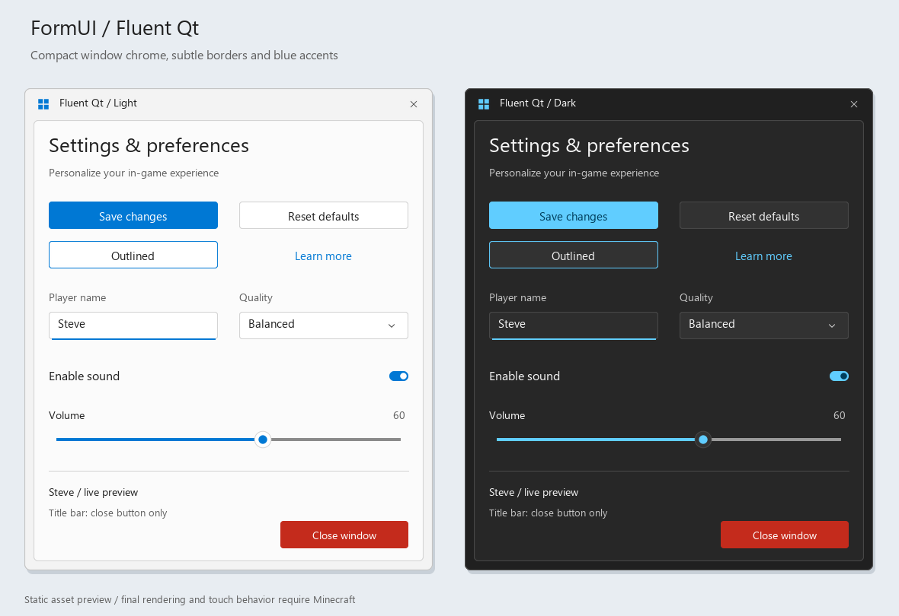

# Fluent Qt 窗口风格内置 UI

参考 [QFluentWidgets](https://github.com/zhiyiYo/PyQt-Fluent-Widgets) 的窗口与控件视觉风格：紧凑标题栏、小圆角按钮、细边框、蓝色强调色，以及浅色和深色配色。通过网易原生 JSON UI 实现，游戏中无需安装 Qt。

标题栏仅提供应用图标、标题和关闭按钮，不包含最小化、最大化或全屏按钮。关闭按钮悬停时显示红色背景。窗口内容放在独立圆角卡片中，支持现有滚动、多列布局、Observable 和各类表单回调。



此图通过随包纹理绘制，并非游戏截图。没有实现 Windows 的 Mica/Acrylic 背景模糊或桌面窗口拖动、调整尺寸行为。

## 游戏预览

在聊天栏输入（不带 `/`）：

- `fui fluent`：浅色窗口，展示所有控件、双列布局和 Observable 绑定。
- `fui fluent-dark`：深色窗口。
- `fui close`：关闭预览。

## 控件标识符

| 类型 | 浅色 class | 深色 class |
| --- | --- | --- |
| 表单面板 | `fluent:light_panel` | `fluent:dark_panel` |
| 主按钮 | `fluent:primary_button` | `fluent:dark_primary_button` |
| 普通按钮 | `fluent:button` | `fluent:dark_button` |
| 描边按钮 | `fluent:outlined_button` | `fluent:dark_outlined_button` |
| 链接式按钮 | `fluent:hyperlink_button` | `fluent:dark_hyperlink_button` |
| 危险操作按钮 | `fluent:danger_button` | `fluent:dark_danger_button` |
| 文本 | `fluent:label` | `fluent:dark_label` |
| 分割线 | `fluent:divider` | `fluent:dark_divider` |
| 开关 | `fluent:toggle` | `fluent:dark_toggle` |
| 滑动条 | `fluent:slider` | `fluent:dark_slider` |
| 输入框 | `fluent:textfield` | `fluent:dark_textfield` |
| 下拉菜单 | `fluent:dropdown` | `fluent:dark_dropdown` |

客户端 UI 初始化时自动注册，可在客户端或服务端表单中引用，也支持 Group 子控件引用。深色面板中的子控件应显式选择深色 class。

内置样式常量同时从 `FormUI.lib` 和独立模块 `FormUI.innerStyles` 导出：

```python
from FormUI.lib import Form, InnerStyles
from FormUI.innerStyles import FluentStyles

form = Form.create('设置', {'class': InnerStyles.fluent.LightPanel})
form.button('保存', style={'class': FluentStyles.PrimaryBtn})
```

`FluentStyles` 包含 `PrimaryBtn`、`NormalBtn`、`OutlinedBtn`、`HyperlinkBtn`、`DangerBtn`、`Label`、`Divider`、`Toggle`、`Slider`、`Textfield`、`Dropdown`。深色控件在对应名称前加 `Dark`，例如 `DarkPrimaryBtn`、`DarkToggle`；面板为 `LightPanel`、`DarkPanel`。`InnerStyles.fluent` 提供相同常量。

```python
from FormUI.lib import Form, Observable

enabled = Observable.create(True)
volume = Observable.create(60)
form = Form.create('设置', {
    'class': 'fluent:light_panel', 'width': '100%y', 'height': '80%',
})
form.label('设置与偏好', {'class': 'fluent:label', 'fontSize': 1.5, 'height': 30})
form.toggle('启用音效', enabled, {'class': 'fluent:toggle'})
form.slider('音量', volume, 0, 100, 1, {'class': 'fluent:slider'})
form.button('保存', {'onClick': lambda playerId: form.close(playerId)},
            {'class': 'fluent:primary_button'})
form.show()  # 服务端传入目标 playerId
```

按钮外部高度 38、内部高度 30；输入框和下拉菜单高度 56；开关高度 38、滑动条高度 52。保持默认高度即可保留控件间距。文字默认采用 `normal` 和 `font_scale_factor: 1.0`，不会随控件尺寸自动缩小；中文使用游戏的字体回退机制。

所有纹理以 4 倍分辨率生成，逻辑尺寸通过 `base_size` 和九宫格切片设置保留，图片启用双线性过滤。

开关本体为 20×10，滑块与圆角按相同比例缩小；文字大小与开关所在行的高度保持不变。开关使用完整胶囊形贴图，关闭九宫格切片，避免小尺寸下两端变尖。

## 维护

- 控件注册：`behavior/scripts/FormUI/core/general/controls/fluent.py`。
- 原生模板：`resource/ui/fluent.json`，已加入 `_ui_defs.json`。
- 纹理资源：`resource/textures/ui/fluent/`。
- `python tools/generate_fluent_ui.py`：重新生成模板与纹理，仅依赖 Python 3 标准库。
- `python tools/preview_fluent_ui.py`：重新生成静态预览，需要 Pillow。
- 游戏示例：`behavior/scripts/example_fluent.py`。

离线检查覆盖注册、控件路径、主题独立性、资源引用、九宫格边界、标题栏按钮和聊天预览。实际渲染、输入与触摸操作需要在游戏内确认。
