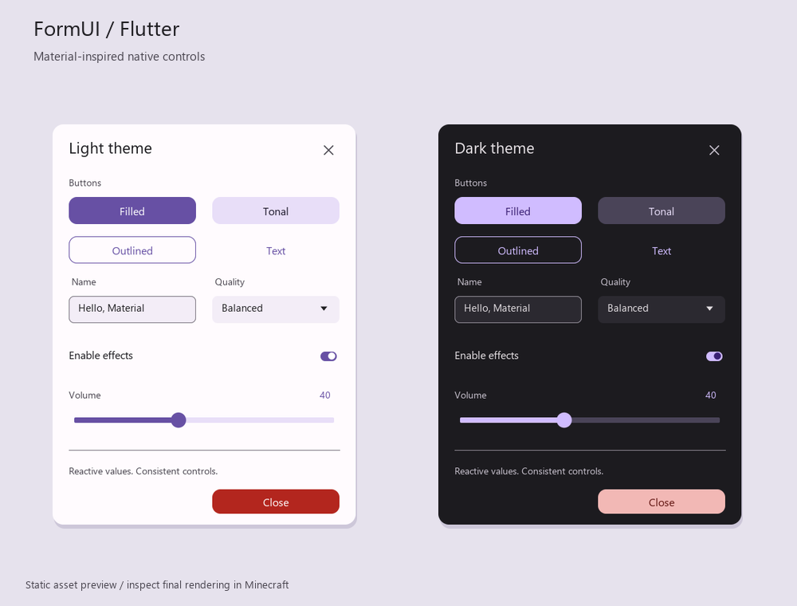

# Flutter 风格内置 UI

参考 Flutter 的 [Material 3 组件](https://docs.flutter.dev/ui/widgets/material)，采用紫色主色、圆角背景、浅色/深色配色，以及默认、悬停、按下三种按钮状态。所有纹理随资源包提供，圆角背景使用九宫格切片，调整宽高时保留圆角。

这是网易原生 JSON UI 的视觉风格，交互由已有 FormUI 控件处理。字体使用游戏提供的 `smooth` 字体；按钮用状态背景反馈点击，没有实现 Flutter 的扩散水波纹动画。

下面是使用项目纹理生成的静态配色预览，实际游戏布局见聊天预览表单。



## 查看效果

加载本项目，在游戏聊天栏输入（不带 `/`）：

- `fui flutter`：浅色预览，包含全部控件、双列布局、回调和 Observable 绑定。
- `fui flutter-dark`：深色预览。
- `fui close`：关闭预览。

## 控件标识符

| 类型 | 浅色 class | 深色 class |
| --- | --- | --- |
| 表单根面板 | `flutter:light_panel` | `flutter:dark_panel` |
| 主按钮 | `flutter:filled_button` | `flutter:dark_filled_button` |
| 次按钮 | `flutter:tonal_button` | `flutter:dark_tonal_button` |
| 描边按钮 | `flutter:outlined_button` | `flutter:dark_outlined_button` |
| 文字按钮 | `flutter:text_button` | `flutter:dark_text_button` |
| 危险操作按钮 | `flutter:danger_button` | `flutter:dark_danger_button` |
| 文本 | `flutter:label` | `flutter:dark_label` |
| 分割线 | `flutter:divider` | `flutter:dark_divider` |
| 开关 | `flutter:toggle` | `flutter:dark_toggle` |
| 滑动条 | `flutter:slider` | `flutter:dark_slider` |
| 输入框 | `flutter:textfield` | `flutter:dark_textfield` |
| 下拉菜单 | `flutter:dropdown` | `flutter:dark_dropdown` |

这些控件在客户端 `UiInitFinished` 时自动注册，客户端、服务端均可通过 class 引用；无需自行调用 `Control.register`。深色面板中的子控件需要显式使用对应的深色 class。Group 的子控件定义同样可以引用这些标识符。

也可以使用内置样式常量，避免手写标识符：

```python
from FormUI.lib import Form, InnerStyles
from FormUI.innerStyles import FlutterStyles

form = Form.create('设置', {'class': InnerStyles.flutter.LightPanel})
form.button('确认', style={'class': FlutterStyles.FilledBtn})
```

`FlutterStyles` 包含 `FilledBtn`、`TonalBtn`、`OutlinedBtn`、`TextBtn`、`DangerBtn`、`Label`、`Divider`、`Toggle`、`Slider`、`Textfield`、`Dropdown`。深色控件在对应名称前加 `Dark`，例如 `DarkFilledBtn`、`DarkToggle`；面板为 `LightPanel`、`DarkPanel`。`InnerStyles.flutter` 提供相同常量。

## 使用示例

```python
from FormUI.lib import Form, Observable

name = Observable.create('Steve')
enabled = Observable.create(True)
volume = Observable.create(50)
quality = Observable.create(1)

form = Form.create('设置', {'class': 'flutter:light_panel'})
form.label('个人设置', {'class': 'flutter:label', 'fontSize': 1.4})
form.textfield('名称', name, {'class': 'flutter:textfield'})
form.toggle('启用音效', enabled, {'class': 'flutter:toggle'})
form.slider('音量', volume, 0, 100, 1, {'class': 'flutter:slider'})
form.dropdown('画质', [
    {'label': '流畅', 'value': 0},
    {'label': '均衡', 'value': 1},
    {'label': '精致', 'value': 2},
], quality, {'class': 'flutter:dropdown'})
form.button('完成', {'onClick': lambda playerId: form.close(playerId)},
            {'class': 'flutter:filled_button'})
form.show()  # 服务端也可以传入 playerId
```

整体尺寸已缩小为初版的 85%，文字、图标、间距和控件同步缩放。默认按钮外部高度 37.4、内部高度 30.6；输入框和下拉菜单高度 54.4，滑动条高度 51，开关高度 37.4。外部高度包含留白，使用 `height: 'default'`（默认）可保留这些间距。更改尺寸时请给圆角和文字留下足够空间。

圆角贴图以 4 倍分辨率生成，例如按钮背景 112×112、面板背景 144×144、输入框背景 80×80。逻辑基础尺寸与物理像素分开，并同步调整九宫格切片，避免提高分辨率后圆角被放大。图片启用双线性过滤。

开关本体缩小为 19.55×11.05，滑块、间距和圆角同步缩小；文字大小与开关所在行的高度保持不变。开关使用完整胶囊形贴图，关闭九宫格切片，避免小尺寸下两端变尖。

现有表单按需传入上述 class。若整个应用使用同一风格，也可以调用 `Screen.setDefaultStyle('button', {'class': 'flutter:filled_button'})`，以及对应的 `label`、`toggle`、`slider`、`textfield`、`dropdown`、`divider` 和 `scrolling_panel` 默认样式。默认样式会跨端同步并影响后续创建的控件。

## 维护

- 注册及原生控件路径：`behavior/scripts/FormUI/core/general/controls/flutter.py`。
- 原生布局：`resource/ui/flutter.json`，已列入 `_ui_defs.json`。
- 纹理：`resource/textures/ui/flutter/`，包含背景、描边、圆形滑块、关闭图标和下拉箭头。
- 开发时运行 `python tools/generate_flutter_ui.py` 可重新生成布局及纹理，配色由脚本中的 `PALETTES` 集中管理。脚本仅使用 Python 3 标准库，游戏中无需运行它。
- `python tools/preview_flutter_ui.py` 可生成上面的静态预览图，该开发工具需要 Pillow。

离线验证覆盖注册标识符、控件路径、模板依赖、纹理切片以及预览构建。游戏实际渲染和触摸操作请通过以上聊天指令检查。
